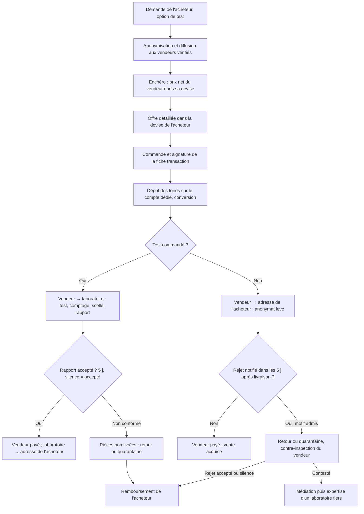

# Offre Opportunity : surplus, obsolètes et brokers, payés à l'acceptation

*Version 0.2 · 11 octobre 2026 · Document de travail, version publique. Statuts : **Décidé**, **Proposé**, **À arbitrer**. Le montage juridique et les contrats sont soumis à un avocat ; ce document n'est pas un avis juridique.*

Cadre général : [`plateforme.md`](plateforme.md).

## 1. Synthèse

- **Ce que c'est** : l'offre de Central.Parts pour les composants issus de surplus (OEM, EMS, distributeurs) et de brokers. Central.Parts conclut l'achat pour le compte de l'acheteur ; le vendeur n'est payé qu'à l'acceptation. **Décidé**
- **Ce qui la distingue** : des vendeurs vérifiés (KYB et abonnement à jour), un lot décrit par un questionnaire d'état qui engage le vendeur, des notes laissées par les acheteurs, et un paiement conservé sur un compte dédié, dans la devise de l'acheteur, jusqu'à l'acceptation. Des laboratoires partenaires peuvent tester les pièces, à la demande de l'acheteur, avant le paiement du vendeur. **Décidé**
- **Anonymat** : acheteur et vendeur restent anonymes l'un pour l'autre jusqu'à l'expédition. Avec test, les pièces transitent par le laboratoire et l'anonymat est préservé ; sans test, il est levé à l'expédition. **Décidé**
- **Comment les prix se forment** : les demandes sont anonymisées et diffusées aux vendeurs vérifiés, qui proposent leur prix net, dans leur devise, par enchère. L'acheteur reçoit une offre détaillée dans sa devise : prix d'achat converti, taux appliqué, frais, commission. Adesio conseille le prix du vendeur. **Décidé**
- **Brokers** : toute offre de broker ou de surplus passe par les rails Opportunity (questionnaire d'état et paiement à l'acceptation), même pour une référence courante. **Décidé**

**Message** : « Ce que le canal agréé n'a plus, tracé et vérifié, payé seulement à l'acceptation. » Au discours « hors canal agréé = contrefaçon », Opportunity répond par la preuve : origine du lot, date code, conditionnement, documents, tests sur demande, notes des acheteurs. **Décidé**

Sur un envoi sans test, « vérifié » porte sur le vendeur et la description du lot, pas sur un test physique : chaque offre indique son parcours (testé ou « en l'état ») et le risque que l'acheteur assume. Cette protection réduit le risque de contrefaçon, elle ne l'élimine pas. **Proposé**

## 2. Cibles et statut « vérifié »

**Statut « vérifié »** : un vendeur de surplus ou un broker est « vérifié » quand sa société a passé le KYB et que son abonnement est à jour. Le statut est affiché sur chaque offre. Seuls les vendeurs vérifiés reçoivent les demandes et peuvent enchérir ; si l'abonnement expire, les transactions en cours vont à leur terme. Le bac à sable reste ouvert sans abonnement pour l'intégration. **Décidé**

- **Vendeurs** : détenteurs de surplus (OEM, EMS, CEM), y compris les excédents de programmes de stock et de consignation des distributeurs agréés ; brokers, notamment en Chine et à Hong Kong. **Décidé**
- **Acheteurs** : EMS, OEM, bureaux d'études et entrepreneurs qui cherchent des références rares, obsolètes ou en fin de vie, y compris pour des préséries. **Décidé**

## 3. Les parties

| Partie | Rôle |
|---|---|
| Acheteur | Émet la demande et donne l'ordre d'achat, dépose les fonds, inspecte ou fait inspecter, accepte ou rejette, note le vendeur |
| Vendeur | Détient le stock ; répond aux demandes par enchère, remplit le questionnaire, expédie |
| Central.Parts | Opère la plateforme, achète pour le compte de l'acheteur, anonymise, consolide et convertit les offres, ordonne l'expédition et le paiement, organise la médiation |
| Établissement financier | Tient le compte dédié où les dépôts des acheteurs sont cantonnés, un compte par devise (à désigner) |
| Laboratoire partenaire | Sur demande de l'acheteur : reçoit les pièces, les teste, les compte, les scelle et les conserve jusqu'à leur réexpédition |
| Adresse de livraison tierce | Intégrateur, sous-traitant ou filiale de l'acheteur, distincte de la facturation, éventuellement hors UE |
| Adesio | Lecture des demandes et des stocks, matching, conseil de prix |

**Cas d'usage de référence** : un entrepreneur français veut des pièces livrées à son intégrateur chinois, testées en laboratoire en route, et 12 échantillons d'une référence en fin de vie pour une présérie. Chaque fonctionnalité doit permettre ce cas sans intervention manuelle.

## 4. Le parcours d'une transaction

Le parcours commence de la même façon, puis se sépare selon que l'acheteur commande ou non un test en laboratoire. **Décidé**

### Étapes communes

| N° | Étape | Acteur | Délai par défaut | Si personne ne réagit |
|---|---|---|---|---|
| 1 | Demande : référence, quantité, date code minimum, emballage, exigences du questionnaire, prix cible, adresse de livraison, option de test | Acheteur | Validité 5 j ouvrés | La demande expire |
| 2 | Enchère sur la demande anonymisée | Vendeurs vérifiés | 24 à 72 h selon l'urgence | Recherche étendue (frais de recherche) ou clôture |
| 3 | Offre détaillée : prix d'achat converti, taux, frais, commission, questionnaire, photos, documents, note du vendeur | Central.Parts | Validité 2 j ouvrés | L'offre expire |
| 4 | Commande, signature électronique de la fiche transaction | Acheteur, puis vendeur | — | — |
| 5 | Dépôt intégral des fonds, puis conversion dans la devise du vendeur | Acheteur | 4 j ouvrés | Annulation |

### Parcours A : avec test en laboratoire, à la demande de l'acheteur

| N° | Étape | Acteur | Délai par défaut | Si personne ne réagit |
|---|---|---|---|---|
| 6 | Expédition au laboratoire, sur ordre de Central.Parts | Vendeur | 5 j ouvrés | Annulation ; principal remboursé à l'acheteur (Décidé) |
| 7 | Test, comptage, photos, scellé ; rapport | Laboratoire | Selon le niveau de test | Relance ; l'acheteur est informé |
| 8 | Acceptation ou rejet du rapport | Acheteur | 5 j ouvrés | **Rapport réputé accepté** (Décidé, validité à confirmer) |
| 9 | Rapport accepté : vente acquise, vendeur payé, pièces réexpédiées à l'adresse désignée | Central.Parts, laboratoire | — | — |
| 10 | Rapport non conforme : pièces non livrées, retour ou quarantaine, acheteur remboursé ; le vendeur peut contester | Central.Parts | Contestation 10 j ouvrés | Remboursement |

### Parcours B : sans test, livraison directe

| N° | Étape | Acteur | Délai par défaut | Si personne ne réagit |
|---|---|---|---|---|
| 6 | Expédition directe à l'adresse de livraison ; l'identité de l'acheteur est communiquée au vendeur | Vendeur | 5 j ouvrés | Annulation ; principal remboursé |
| 7 | Livraison confirmée par le transporteur ; inspection | Acheteur ou son intégrateur | 5 j ouvrés après livraison | **Vente réputée acquise**, le vendeur est payé (Décidé) |
| 8 | Rejet notifié : motif admis et justificatifs, fonds gelés | Acheteur | Dans le délai | — |
| 9 | Retour ou quarantaine, contre-inspection | Vendeur | 10 j ouvrés après réception du retour | **Rejet accepté**, l'acheteur est remboursé |
| 10 | Médiation | Central.Parts | 15 j | Expertise d'un laboratoire tiers, qui tranche |

### Règles communes (Proposé, sauf mention)

- Délais en jours ouvrés, heure de Paris, prolongation seulement d'un commun accord ; plage de 1 à 30 jours choisie à la commande, valeurs ci-dessus par défaut.
- Un minuteur visible et des relances automatiques remplacent tout décompte manuel.
- Avec test, l'acceptation du rapport vaut acceptation de la vente pour ce que le niveau de test a vérifié ; il ne se conteste que pour irrégularité (niveau non respecté, lot différent, quantité).
- Sans test, motifs de rejet admis (liste fermée) : contrefaçon ou soupçon documenté, non-conformité à la description ou au questionnaire, écart de quantité, dommage de transport. Les défauts non annoncés qu'un test aurait révélés restent à la charge de l'acheteur.
- Rejet sans test : photos horodatées à réception, pièces non utilisées et conservées dans leur emballage ESD, retour sous 5 j ouvrés avec l'étiquette fournie par Central.Parts. En cas de contrefaçon, les pièces vont en quarantaine dans un laboratoire partenaire, jamais au vendeur.
- Qui paie : rejet justifié, frais de retour et d'expertise à la charge du vendeur, acheteur remboursé du montant déposé dans sa devise ; rejet injustifié, frais à la charge de l'acheteur, vendeur payé. La commission rémunère le service, y compris le traitement du rejet (Décidé).
- Rejet partiel admis, ligne par ligne.
- Ordres de paiement et de remboursement validés par deux opérateurs distincts avant transmission à la banque.
- La fraude du vendeur n'est jamais couverte par une renonciation de l'acheteur.

### Contrefaçon : suspension et recours (Décidé)

- **Suspension conservatoire** : dès un signalement de contrefaçon documenté (photos du marquage, de l'étiquette, de l'emballage, éléments de comparaison ; un simple avis négatif ne suffit pas), le compte du vendeur est suspendu. Il perd le statut « vérifié », ne reçoit plus de demandes, ses offres sont retirées ; il garde l'accès pour répondre. Les transactions du lot signalé sont gelées, les autres suivent leur cours. Notification motivée, réponse sous 5 j ouvrés, décision sous 10 j ouvrés ; si la suspension est levée à tort, l'abonnement est prolongé d'autant. Signalement aux bases sectorielles seulement après expertise.
- **Signalement tardif** (vendeur déjà payé) : Central.Parts ne rembourse pas sur ses propres fonds ; il remet à l'acheteur le dossier utile à son recours contre le vendeur (identité issue du KYB, fiche transaction, questionnaire, documents, photos, preuve de livraison, échanges). En option payante, Central.Parts agit pour le compte de l'acheteur contre le vendeur, avec une obligation de moyens. Fenêtre de signalement : 6 mois après la livraison (Proposé).

### Livraison et douane (Proposé, sauf mention)

- Incoterm DAP : vendeur vers laboratoire avec test, vendeur vers adresse de livraison sans test ; laboratoire vers acheteur après acceptation du rapport, aux frais de l'acheteur, transport organisé par Central.Parts.
- Central.Parts n'est jamais importateur de record au lancement. L'acheteur désigne l'importateur du pays de destination et son transitaire ; la livraison peut se faire hors UE, par exemple achat à Shanghai, test à Hong Kong, livraison à Shenzhen. **Décidé**

## 5. Annonces et stock

### 5.1 Canaux et formats

- Priorité aux brokers qui ont une API produit interrogeable : Central.Parts l'interroge en direct à chaque demande et ne garde qu'un instantané des lots trouvés. Puis envoi vers l'API fournisseur ([`api/fournisseurs.md`](../../api/fournisseurs.md)), puis fichiers CSV, XLS et SFTP au-delà de 500 000 lignes. **Décidé** (ADR 0007)
- Formats reconnus : format broker (Manufacturer, SKU, MPN, Product URL, Unit Price, Quantity, Price per 10 / 100 / 1 000 pcs), Octopart, ECIA. **Décidé**
- Champs obligatoires : référence fabricant, fabricant, quantité. Facultatifs : SKU, prix, devise, paliers, date code, pays d'origine, conditionnement, délai. **Décidé**
- Devises acceptées, celles des comptes de Central.Parts : EUR, USD, CNH (yuan offshore ; CNY et RMB acceptés comme CNH), HKD, GBP, JPY. Une autre devise est refusée. **Décidé**
- Le date code peut manquer dans le stock d'un broker : il est demandé quand le broker est consulté, dans sa réponse à la demande. **Décidé**
- Doublons : un même lot proposé par plusieurs détenteurs ou brokers est identifié et affiché une seule fois (types de stock ECIA : réel, usine, doublon). **Proposé**

### 5.2 Questionnaire d'état

Rempli par le vendeur dans l'annonce, réponse fermée et commentaire libre à chaque question. Les réponses engagent le vendeur et priment sur ses exclusions de garantie ; elles fondent le droit de rejet pour non-conformité. L'acheteur peut filtrer sur chaque réponse. **Proposé**

1. Origine du stock : stock propre, acheté chez un distributeur agréé, surplus OEM/EMS, autre broker, refuse de répondre
2. Pièces déjà vendues une première fois ?
3. Retours qualité déjà subis ?
4. Neuf ou usagé
5. État visuel
6. Pièces testées ? Par qui ?
7. État fonctionnel
8. Date codes homogènes ?
9. Emballage d'origine du fabricant ?
10. Emballage d'origine ouvert ?
11. Type d'emballage : bande et bobine, plateau, tube, vrac
12. Conditions de stockage (température, humidité, sachet étanche pour les composants sensibles à l'humidité)
13. Autre problème connu ?

« Refuse de répondre » reste possible mais visible de l'acheteur. Pour les gros stocks de brokers : modèle par défaut rempli une fois, confirmé ou corrigé en répondant à une demande. **À arbitrer**

### 5.3 Documents qualité par lot

Liste fixe, chaque document marqué « fourni » ou « absent » : photos obligatoires (étiquette, marquage, conditionnement), certificat de conformité du fabricant ou du distributeur, preuve d'achat d'origine si disponible, datasheet (lien vers le site du fabricant), rapport d'inspection. **Proposé**

### 5.4 Statuts et notes

- Origine du stock affichée sur chaque annonce. **Décidé**
- Statut de Central.Parts affiché clairement sur cette offre : non agréé par les fabricants. **Proposé**
- Interrupteur « commande ouverte / fermée » sur la demande ; statut « vu / non vu » des offres. **Proposé**
- **Notes des vendeurs** : seuls les acheteurs d'une transaction réelle notent, après acceptation ou rejet ; critères : conformité à la description, date code et emballage, délai d'expédition, communication, avec un signalement distinct pour contrefaçon présumée. La note est affichée sur l'offre et peut peser dans le classement, sans jamais dépendre d'un paiement du vendeur. Un seuil de notes ou une contrefaçon confirmée peut retirer le statut « vérifié », avec droit de réponse. **Décidé** (principe ; modalités Proposé)

## 6. Anonymisation et enchères

- Identités masquées dans les deux sens jusqu'à l'expédition ; préservées de bout en bout avec test ; levées à l'expédition sans test, avec le consentement des deux parties prévu au contrat et la clause de non-contournement. **Décidé**
- Le vendeur voit : référence, quantité, date code minimum, exigences d'emballage et de questionnaire, zone de livraison (pays ou région, jamais l'adresse), délai souhaité. **Proposé**
- Les messages aux vendeurs (e-mail, WeChat, WeCom) ne contiennent que ce qu'il faut pour chiffrer, jamais le nom ni l'adresse de l'acheteur. **Décidé**
- Le vendeur propose son prix net dans sa devise avec le date code du lot ; Adesio lui indique une fourchette conseillée dans cette devise. **Décidé**
- Enchère inversée à offres scellées, avec indication du rang au vendeur ; plusieurs offres classées peuvent être présentées. **Proposé**
- Classement sur l'équivalent en euros, puis sur la note du vendeur et la qualité de l'offre. Le classement Opportunity ne dépend jamais d'un paiement du vendeur. **Décidé**
- Chaque offre indique que Central.Parts perçoit aussi des frais de plateforme auprès des vendeurs ; le prix d'achat affiché est celui réellement payé au vendeur. **Décidé**

## 7. Laboratoires partenaires

- Le test est commandé par l'acheteur ; il n'est pas systématique. **Décidé**
- Le laboratoire reçoit les pièces, les teste, les compte, les photographie et les scelle, puis les réexpédie à l'adresse désignée après acceptation du rapport. **Décidé**
- L'acceptation du rapport par l'acheteur vaut acceptation de la vente et déclenche le paiement du vendeur. **Décidé**
- Le rapport indique précisément ce qui a été testé, la quantité comptée et l'état du lot. **Proposé**
- Niveaux de test choisis à la commande, avec prix et délai affichés : contrôle visuel et marquage ; rayons X ; XRF ; décapsulation ; test électrique. **Proposé**
- Contrefaçon : les pièces ne sont jamais renvoyées au vendeur ; quarantaine ou destruction avec preuve. **Proposé**
- Litige sur la conformité : un second laboratoire indépendant tranche ; frais à la charge de la partie perdante. **Proposé**
- Frais de laboratoire si le rapport conclut à la non-conformité : à la charge du vendeur ou non. **À arbitrer**
- Réseau visé : 2 ou 3 laboratoires en Europe, puis un en Asie. **Proposé**

## 8. Échantillonnage

- Service payant. **Décidé**
- Échantillons prélevés dans le même lot et le même date code, avec photo du lot au prélèvement. **Proposé**
- Mini-transaction payée à l'acceptation, avec option de test en laboratoire. **Proposé**
- Option d'achat du lot principal à prix fixé pendant une durée donnée (par exemple 15 jours). **Proposé**
- L'acceptation des échantillons ne vaut pas acceptation du lot principal, sauf mention contraire dans la fiche transaction. **Proposé**

## 9. Modèle économique

| Poste | Payé par | Statut |
|---|---|---|
| Prix d'achat : prix net du vendeur converti, taux affiché | Acheteur | Décidé |
| Commission de Central.Parts, ligne distincte | Acheteur | Décidé, taux à fixer |
| Marge de change, ligne distincte avec le taux de référence | Acheteur | Décidé, taux à fixer |
| Frais de recherche étendue | Acheteur | Décidé, barème à fixer |
| Frais d'opération (banque, change, traitement) | Acheteur | Décidé, barème à fixer |
| Abonnement vendeur (condition du statut « vérifié ») | Vendeur | Décidé : gratuit jusqu'à la première vente, payant ensuite (ADR 0013) |
| Frais de plateforme | Vendeur | Décidé, au lancement |
| Forfait par transaction, frais de vente par paliers de valeur | Vendeur | Décidé, après le lancement |
| Emplacements sponsorisés, uniquement sur le catalogue Inventory | Vendeur | Décidé, après le lancement |
| Laboratoire | Acheteur, sauf non-conformité | Proposé |
| Échantillonnage : forfait plus prix des pièces | Acheteur | Décidé, barème à fixer |
| Service de recours contre le vendeur (option) | Acheteur | Décidé, tarif à fixer |
| Transport | Selon l'Incoterm de la fiche | Proposé |
| Non-expédition : remboursement du principal à l'acheteur | — | Décidé |
| Pénalité de non-expédition à la charge du vendeur | Vendeur | À arbitrer |

### Change (Décidé)

- Le prix d'achat est converti à l'offre : taux de référence de la BCE, plus une marge de change affichée sur une ligne distincte ; taux figé pendant la validité de l'offre (2 j ouvrés).
- Au dépôt, les fonds sont convertis dans la devise du vendeur et conservés dans cette devise jusqu'au paiement ; le vendeur reçoit exactement son prix net, moins ses frais.
- Rejet justifié : l'acheteur est remboursé du montant déposé, dans sa devise ; l'écart de change éventuel est porté par Central.Parts.
- Les vendeurs asiatiques sont payés en USD par défaut ; CNH, HKD et JPY quand l'établissement financier le permet.

## 10. Cadre contractuel

| Document | Signé |
|---|---|
| Conditions générales de la plateforme | À l'inscription |
| Contrat-cadre acheteur | Une fois, après le KYB |
| Contrat-cadre vendeur | Une fois, après le KYB |
| Conditions de l'API fournisseur | À la création de la première clé |
| Fiche transaction : prix détaillé, devise et taux, parcours, laboratoire, adresses, Incoterm | À chaque commande, signature électronique |
| Convention laboratoire | Avec chaque laboratoire |

Principes retenus : contrats acheteur et vendeur dos à dos (mêmes motifs, mêmes délais, même procédure de litige) ; paiement du vendeur conditionné à l'acceptation, expresse ou réputée ; réponses du questionnaire intégrées à la commande ; remboursements uniquement vers le compte autorisé au KYB (Décidé) ; non-contournement de 6 mois après chaque transaction (Décidé) ; contrats en français et en anglais, la version française fait foi, traduction chinoise d'information. La rédaction est confiée à un avocat.

## 11. Fonctionnalités

### 11.1 Premier lancement

- Espaces acheteur, vendeur, laboratoire, administration et console de l'établissement financier
- KYB à l'inscription, compte bancaire autorisé, contrôle des sanctions
- Stock vendeur : connecteurs aux API produit, API fournisseur, import CSV ou XLS, SFTP, questionnaire et documents par lot ; bac à sable
- Demande avec option de test, enchère anonymisée multidevise, offre détaillée, encaissement dans la devise de l'acheteur, paiement du vendeur dans la sienne
- Deux parcours de transaction : avec test et sans test
- Notifications des vendeurs : webhooks, e-mail, WeCom, WeChat, dans leur langue
- Fiche transaction et signature électronique
- Tableau de bord de la transaction : étape en cours, minuteur, documents, historique
- Boutons « J'accepte / Je rejette » avec justificatifs téléversés ; acceptation du rapport de laboratoire
- Notes des vendeurs, signalement de contrefaçon, suspension conservatoire
- Relances automatiques, étiquettes de retour
- Ordres de paiement et de remboursement transmis à l'établissement financier, avec double validation interne

### 11.2 Ensuite

- Échantillonnage avec option d'achat
- Connexion directe aux laboratoires (dépôt des rapports)
- Réponse aux demandes depuis WeChat, autres messageries (DingTalk, Feishu, WhatsApp)
- API pour les ERP des acheteurs
- Diffusion du stock sur des canaux tiers, après étude de leurs conditions

La maquette en ligne (`/app/`) ne montre pas encore les deux parcours, le prix détaillé, les notes ni la suspension.
